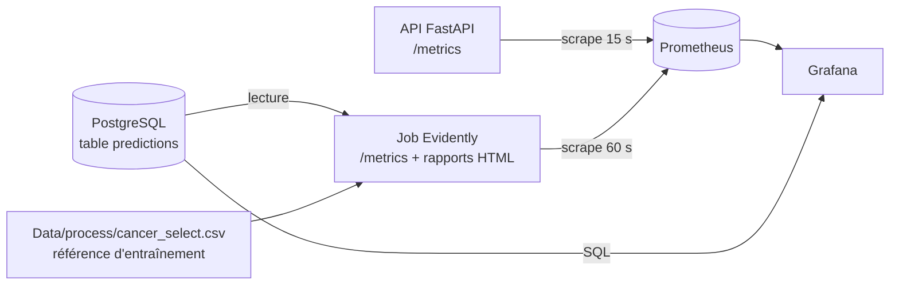

# Monitoring OncoScan : Prometheus, Grafana, Evidently

Cette stack se superpose aux services existants (`postgres`, `api`, `interface`) sans les modifier.



| Outil | Rôle | Accès |
|---|---|---|
| **Prometheus** | Collecte et stocke les métriques (30 jours), évalue les alertes | http://localhost:9090 |
| **Grafana** | Dashboards *OncoScan - API* et *OncoScan - Modèle* | http://localhost:3000 |
| **Evidently** | Drift des données vs entraînement + performance réelle (feedback médecins) | http://localhost:8085 |

Tous les ports sont liés à `127.0.0.1` : rien n'est exposé publiquement.

## Démarrage

1. Renseigner dans `.env` (voir `.env.example`) `GRAFANA_ADMIN_USER`, `GRAFANA_ADMIN_PASSWORD`
   et, de préférence, l'utilisateur en lecture seule `MONITORING_DB_USER` / `MONITORING_DB_PASSWORD`.
2. Lancer :
   ```bash
   docker compose -f docker-compose.yml -f docker-compose.monitoring.yml up -d --build
   ```
   En production (images Docker Hub, dont `oncoscan-evidently` publiée par la CI) : remplacer
   `docker-compose.yml` par `docker-compose.prod.yml`. Le dossier `Monitoring/` et
   `Data/process/cancer_select.csv` doivent être présents sur le serveur.
3. Ouvrir Grafana et se connecter avec **`GRAFANA_ADMIN_USER` / `GRAFANA_ADMIN_PASSWORD`**.
   Ce n'est pas un compte de l'application OncoScan : Grafana a ses propres utilisateurs.
   Les dashboards sont dans le dossier **OncoScan**.

### Recommandé : utilisateur PostgreSQL en lecture seule

Par défaut, Grafana et Evidently utilisent `DB_USER`, qui a les droits d'écriture. Pour un utilisateur qui ne peut lire que la table `predictions` :

```bash
docker compose exec -T postgres sh -c 'psql -U "$POSTGRES_USER" -d "$POSTGRES_DB" -v ro_password="MOT_DE_PASSE"' < Monitoring/sql/readonly_user.sql
```

Puis dans `.env` : `MONITORING_DB_USER=oncoscan_monitoring`, `MONITORING_DB_PASSWORD=MOT_DE_PASSE`, et relancer la commande `up -d`.
Le script peut être relancé sans risque : il met simplement le mot de passe à jour.

## Ce qui est mesuré

### API (Prometheus, via `prometheus-fastapi-instrumentator`)
- `http_requests_total{handler, method, status}` : trafic et erreurs par endpoint
- `http_request_duration_seconds` : latence (p50 / p95 / p99)
- `oncoscan_predictions_total{prediction}` : nombre de prédictions M / B
- `oncoscan_probability_malignant` : distribution des probabilités renvoyées
- `oncoscan_inference_seconds` : temps de calcul du modèle seul

`/health` et `/metrics` sont exclus des statistiques.

### Modèle (job Evidently, toutes les heures sur les 30 derniers jours)
- `oncoscan_drift_share`, `oncoscan_feature_drift_score{feature}`, `oncoscan_feature_drifted{feature}` : drift des 5 variables et de la classe prédite par rapport aux données d'entraînement
- `oncoscan_feature_mean{feature, dataset}`, `oncoscan_malignant_share{dataset}` : production vs entraînement
- `oncoscan_live_recall`, `oncoscan_live_precision`, `oncoscan_live_accuracy`, `oncoscan_live_false_negatives` : performance réelle sur les cas où un médecin a renseigné `doctor_feedback`
- `oncoscan_monitoring_last_run_success` : état du job

Le drift n'est calculé qu'à partir de `EVIDENTLY_MIN_ROWS` prédictions (30 par défaut). En dessous, les panneaux de drift restent vides : un test statistique sur 5 lignes n'a pas de sens.
Un rapport HTML Evidently détaillé est généré à chaque calcul (48 derniers conservés) : http://localhost:8085.

### Alertes (`Monitoring/prometheus/alerts.yml`)
API indisponible, plus de 5 % d'erreurs 5xx, latence p95 > 500 ms, job Evidently en échec, plus de 50 % des variables en drift, recall réel < 0.9. Elles sont visibles dans Prometheus (onglet *Alerts*). Pour recevoir des notifications (mail, Slack…), il faut ajouter Alertmanager ou configurer des alertes Grafana.

## Fichiers

```
Monitoring/
├── prometheus/prometheus.yml      # cibles : api:8000, evidently:8085
├── prometheus/alerts.yml          # règles d'alerte
├── grafana/provisioning/          # sources de données + chargement des dashboards
├── grafana/dashboards/*.json      # dashboards (modifs dans l'UI : exporter le JSON ici)
├── evidently/                     # job de drift (Dockerfile, drift_job.py)
└── sql/readonly_user.sql          # utilisateur PostgreSQL en lecture seule
docker-compose.monitoring.yml      # les 3 services
```

## Grafana : impossible de se connecter

- **« Invalid username or password » / « user not found » dans les logs** : l'identifiant saisi
  n'est pas celui de `GRAFANA_ADMIN_USER` (par défaut `admin`). Les comptes de l'application ne
  fonctionnent pas dans Grafana.
- **Mot de passe changé dans `.env` après le premier démarrage** : Grafana ne crée le compte admin
  qu'une fois, quand le volume `grafana-data` est vide. Pour réaligner le mot de passe sur le `.env` :
  ```bash
  docker compose -f docker-compose.yml -f docker-compose.monitoring.yml exec grafana sh -c 'grafana cli admin reset-admin-password "$GF_SECURITY_ADMIN_PASSWORD"'
  ```
- **Compte bloqué après plusieurs essais** : Grafana bloque l'identifiant quelques minutes après
  5 échecs. Attendre, puis réessayer.

## Arrêt

```bash
docker compose -f docker-compose.yml -f docker-compose.monitoring.yml down
```

Ajouter `-v` supprime **aussi** la base PostgreSQL (`pgdata`). Pour ne supprimer que les données de monitoring :
`docker volume rm <projet>_prometheus-data <projet>_grafana-data <projet>_evidently-reports`.
