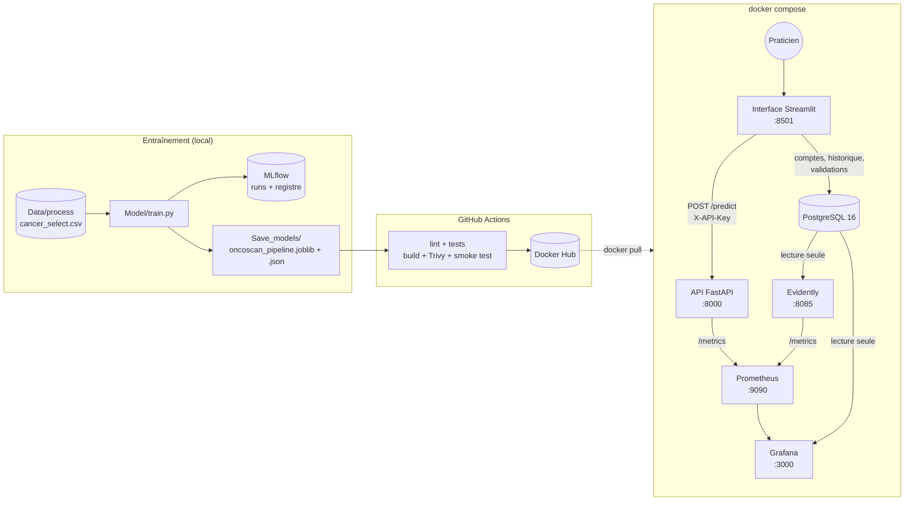
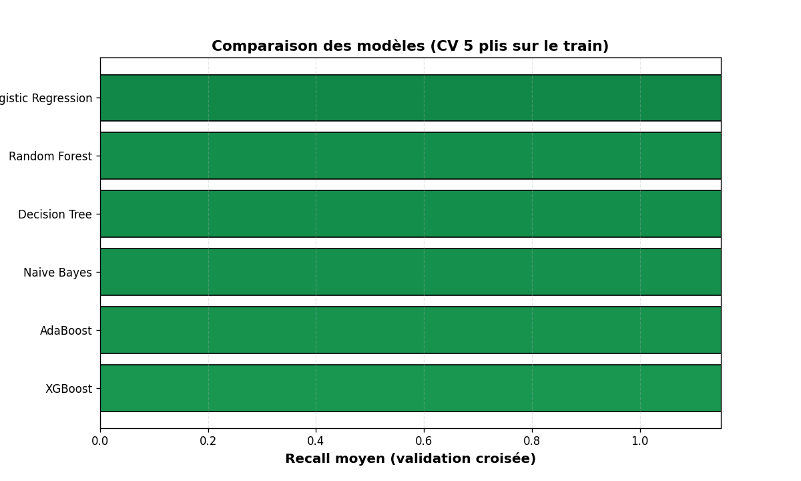
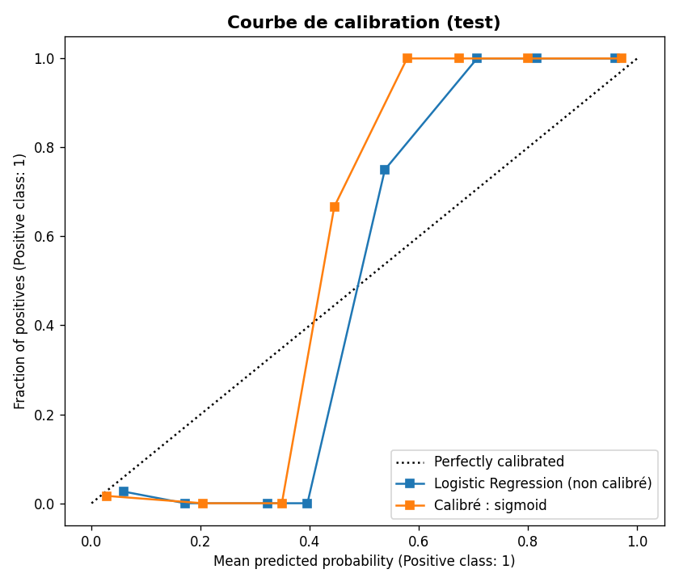
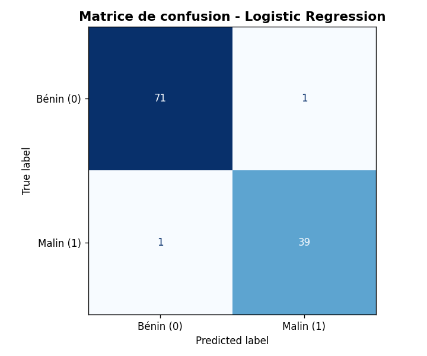
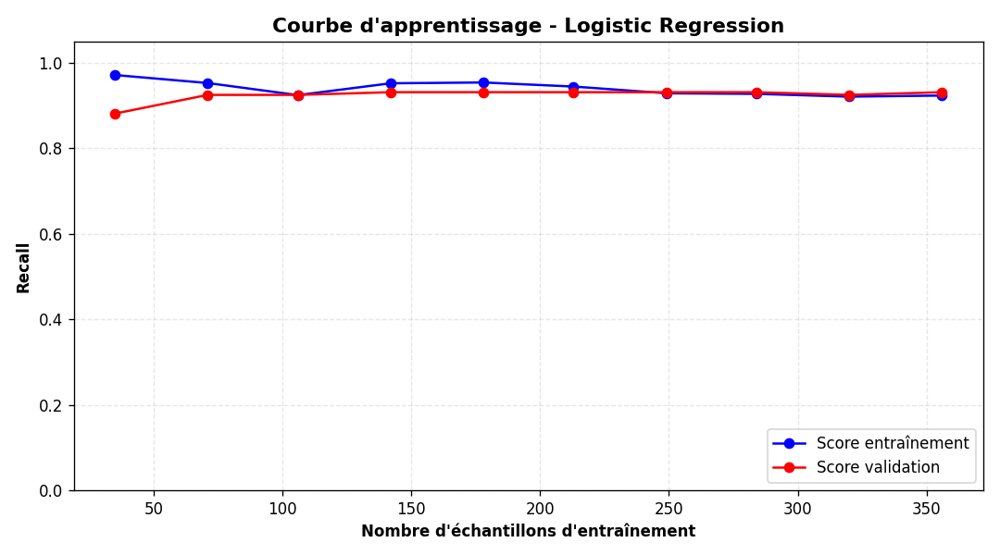
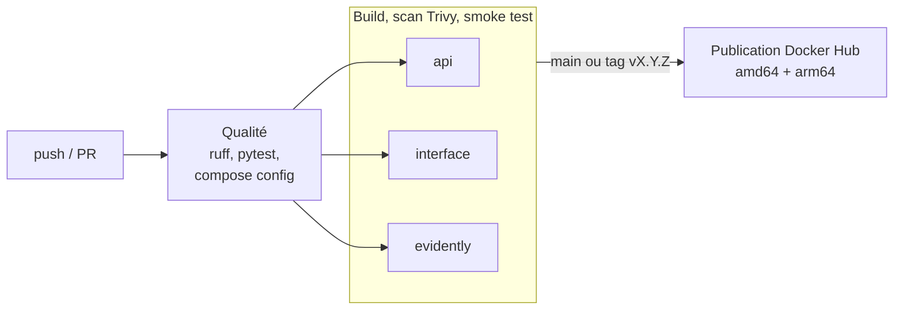

<div align="center">
  
  <h1>OncoScan</h1>
  <p><strong>Un projet MLOps complet et open source, de la donnée brute au monitoring en production.</strong></p>

  <p>
    
    
    
    
    
    
    <br>
    
    
    
    
    
    
  </p>
</div>

> [!IMPORTANT]
> OncoScan est un **projet de démonstration**. Le modèle est entraîné sur un petit jeu de données public
> (569 patients) et n'a aucune valeur clinique : il ne doit jamais servir à une décision médicale.
> L'objet du projet est la **démarche MLOps**, pas la performance du modèle.

## En bref

OncoScan classe une tumeur mammaire comme bénigne ou maligne à partir de 5 mesures de noyaux cellulaires.
Le cas d'usage sert de prétexte pour montrer, avec uniquement des outils open source, ce qu'il faut autour
d'un modèle pour qu'il soit **fiable, traçable, déployable et surveillé** :

| Étape | Ce qui est fait | Outils |
|---|---|---|
| Expérimentation | Comparaison de 6 algorithmes en validation croisée, calibration des probabilités, seuil de décision choisi pour le recall | scikit-learn, XGBoost |
| Traçabilité | Chaque entraînement est enregistré (paramètres, métriques, figures, empreinte des données, commit git) et le modèle est versionné dans un registre | MLflow |
| Qualité | 35 tests automatisés (modèle + API), lint et règles de sécurité | pytest, ruff |
| Service | API d'inférence authentifiée, interface web pour les praticiens, historique en base | FastAPI, Streamlit, PostgreSQL |
| Livraison | Images Docker durcies, scan de vulnérabilités, test de démarrage, publication multi-architecture | Docker, Trivy, GitHub Actions, Docker Hub |
| Production | Métriques techniques, drift des données, performance réelle mesurée grâce aux validations des médecins, alertes | Prometheus, Grafana, Evidently |

## Sommaire

- [En bref](#en-bref)
- [Sommaire](#sommaire)
- [1. Architecture](#1-architecture)
- [2. Démarrage rapide](#2-démarrage-rapide)
- [3. Données et modèle](#3-données-et-modèle)
  - [Les données](#les-données)
  - [La démarche d'entraînement](#la-démarche-dentraînement)
  - [Résultats (jeu de test, 112 patients)](#résultats-jeu-de-test-112-patients)
  - [La fiche du modèle](#la-fiche-du-modèle)
- [4. Suivi des expériences avec MLflow](#4-suivi-des-expériences-avec-mlflow)
- [5. API d'inférence](#5-api-dinférence)
- [6. Interface web](#6-interface-web)
- [7. Monitoring](#7-monitoring)
- [8. Tests et qualité](#8-tests-et-qualité)
- [9. CI/CD](#9-cicd)
- [10. Sécurité](#10-sécurité)
  - [Rotation des secrets](#rotation-des-secrets)
- [11. Configuration](#11-configuration)
- [12. Structure du dépôt](#12-structure-du-dépôt)
- [13. Dépannage](#13-dépannage)
- [14. Limites et pistes d'amélioration](#14-limites-et-pistes-damélioration)
- [15. Auteur et licence](#15-auteur-et-licence)

## 1. Architecture



| Service | Rôle | Accès depuis l'hôte |
|---|---|---|
| `interface` | Application Streamlit : connexion, analyses, historique, validation des diagnostics | http://localhost:8501 |
| `api` | Inférence FastAPI, modèle embarqué dans l'image | http://127.0.0.1:8000/docs |
| `postgres` | Comptes praticiens, prédictions, validations | aucun (réseau Docker interne) |
| `prometheus` | Collecte des métriques et règles d'alerte | http://127.0.0.1:9090 |
| `grafana` | Dashboards technique et modèle | http://127.0.0.1:3000 |
| `evidently` | Calcul du drift et de la performance réelle, rapports HTML | http://127.0.0.1:8085 |

La base n'est joignable que par l'interface et les outils de monitoring (réseau `db-net`, sans accès
extérieur). L'API ne voit pas la base : elle n'en a pas besoin.

## 2. Démarrage rapide

**Prérequis** : Docker avec Compose v2, Git. Python 3.12 seulement pour entraîner le modèle ou lancer les tests.

```bash
git clone https://github.com/Schaphath/MLops-Project-Tuto-Python.git
cd MLops-Project-Tuto-Python
cp .env.example .env
```

Remplacer chaque `change-me` du `.env` par une vraie valeur. Pour générer un secret :

```bash
python -c "import secrets; print(secrets.token_urlsafe(32))"
```

Lancer l'application seule :

```bash
docker compose up -d --build
```

Ou l'application avec toute la stack de monitoring :

```bash
docker compose -f docker-compose.yml -f docker-compose.monitoring.yml up -d --build
```

Ouvrir http://localhost:8501. Pour créer le premier compte, mettre `ALLOW_REGISTRATION=true` dans le `.env`,
relancer, créer les comptes, puis revenir à `false`.

Pour déployer sans le code source, à partir des images publiées sur Docker Hub, utiliser
`docker-compose.prod.yml` à la place de `docker-compose.yml`.

## 3. Données et modèle

### Les données

Jeu [Breast Cancer Wisconsin (Diagnostic)](https://archive.ics.uci.edu/dataset/17/breast+cancer+wisconsin+diagnostic) :
569 ponctions à l'aiguille fine, 30 mesures par image. Après nettoyage (voir `Notebook/Analyse-Exploratoire.ipynb`),
il reste 557 lignes, dont 36 % de tumeurs malignes.

| Fichier | Contenu |
|---|---|
| `Data/raw/cancer.csv` | Données brutes |
| `Data/process/cancer_clean.csv` | Après nettoyage, valeurs « worst » uniquement |
| `Data/process/cancer_select.csv` | Les 5 variables retenues + le diagnostic : **c'est le fichier d'entraînement** |

Le modèle utilise 5 variables, toutes en version « worst » (moyenne des 3 noyaux les plus atypiques de l'image) :

| Variable | Signification | Bornes acceptées par l'API |
|---|---|---|
| `perimeter` | Périmètre des noyaux | 40 < x ≤ 250 |
| `concave_points` | Part du contour présentant des creux | 0 ≤ x ≤ 0,3 |
| `texture` | Écart-type des niveaux de gris | 5 < x ≤ 50 |
| `smoothness` | Variation locale du rayon | 0,01 < x ≤ 0,3 |
| `symmetry` | Symétrie de la forme | 0,05 < x ≤ 0,7 |

Les mêmes bornes sont appliquées à trois endroits : l'API (Pydantic), l'interface (formulaire) et la base (`CHECK`).

### La démarche d'entraînement

`Model/train.py` suit un protocole qui évite les deux pièges classiques : évaluer sur des données qui ont
servi à choisir le modèle, et optimiser une métrique qui n'a pas de sens pour le problème.

1. **Découpage** 80/20 stratifié. Le jeu de test (112 lignes) n'est utilisé qu'une seule fois, à la fin.
2. **Choix de l'algorithme** parmi 6 candidats (régression logistique, arbre, forêt aléatoire, XGBoost,
   AdaBoost, Naive Bayes) en validation croisée à 5 plis sur le train. Critère : le meilleur recall parmi
   les modèles qui gardent au moins 90 % de précision.
3. **Calibration** des probabilités (sigmoid) si, et seulement si, elle améliore le score de Brier et la
   log loss en validation croisée. Un « risque de 30 % » affiché au praticien doit vraiment correspondre à 30 %.
4. **Seuil de décision** choisi pour maximiser le recall à précision ≥ 90 %, au lieu du 0,5 par défaut.
   Rater une tumeur maligne coûte bien plus cher qu'une fausse alerte.
5. **Évaluation finale** sur le test, sauvegarde du modèle et de sa fiche, traçage dans MLflow.

```bash
pip install -r Model/requirements_train.txt
python Model/train.py
```

### Résultats (jeu de test, 112 patients)

Modèle retenu : **régression logistique calibrée (sigmoid), seuil 0,352**.

| Recall | Précision | F1 | AUC | Brier (avant → après calibration) |
|---|---|---|---|---|
| 0,975 | 0,975 | 0,975 | 0,980 | 0,045 → 0,028 |

Sur les 40 tumeurs malignes du test, une seule est manquée.

<p align="center">
  
  
</p>
<p align="center">
  
  
</p>

### La fiche du modèle

À chaque entraînement, `Save_models/oncoscan_pipeline.json` est écrit à côté du modèle : algorithme,
calibration, seuil, variables, version de scikit-learn, date, métriques de test. L'API la sert sur `/model`
et les tests vérifient que le modèle et sa fiche sont cohérents.

## 4. Suivi des expériences avec MLflow

Chaque exécution de `train.py` crée un run MLflow contenant :

- les **paramètres** (algorithme retenu, calibration, seuil, variables, découpage) ;
- les **métriques** de test et les scores de validation croisée de chacun des 6 candidats ;
- les **figures**, le rapport de classification et la fiche du modèle ;
- l'**empreinte SHA-256 du fichier de données** et le **commit git** : on sait exactement avec quoi un modèle a été produit ;
- le **modèle lui-même**, inscrit au registre sous le nom `oncoscan` (une nouvelle version par entraînement).

Par défaut, tout est stocké en local (`mlflow.db` et `mlruns/`, ignorés par git). Pour consulter les expériences :

```bash
mlflow ui --backend-store-uri sqlite:///mlflow.db
```

puis ouvrir http://127.0.0.1:5000. Pour utiliser un serveur MLflow partagé, définir `MLFLOW_TRACKING_URI`
avant de lancer l'entraînement.

Le fichier `Save_models/oncoscan_pipeline.joblib` reste la source de vérité pour le déploiement : il est
embarqué dans l'image de l'API, donc **un tag d'image correspond à un modèle précis**.

## 5. API d'inférence

| Méthode | Route | Authentification | Rôle |
|---|---|---|---|
| `GET` | `/` | non | Nom, version, statut |
| `GET` | `/health` | non | État du modèle (utilisé par le healthcheck Docker) |
| `GET` | `/model` | non | Fiche du modèle servi |
| `POST` | `/predict` | `X-API-Key` | Prédiction |
| `GET` | `/metrics` | non | Métriques Prometheus |
| `GET` | `/docs` | non | Documentation interactive (Swagger) |

```bash
curl -s http://127.0.0.1:8000/predict \
  -H "X-API-Key: $API_KEY" -H "Content-Type: application/json" \
  -d '{"perimeter": 87.46, "concave_points": 0.04781, "texture": 17.77, "smoothness": 0.08474, "symmetry": 0.1812}'
```

```json
{"prediction": "B", "label": "Bénigne", "probability_malignant": 0.0018, "model_version": "2.3.0"}
```

Toute valeur hors bornes, tout champ manquant ou inconnu renvoie `422`. Une clé absente ou fausse renvoie `401`.

## 6. Interface web

- **Connexion** des praticiens (mots de passe hachés avec bcrypt, blocage temporaire après 5 échecs).
- **Nouvelle analyse** : identifiant patient pseudonymisé et 5 mesures, résultat avec le risque de malignité estimé.
- **Historique** des 50 dernières analyses du praticien, filtrable et exportable en CSV.
- **Validation d'un diagnostic** : une fois le résultat d'anatomopathologie connu, le praticien indique le
  diagnostic réel. Ces validations alimentent le monitoring, qui mesure ainsi la **performance réelle** du
  modèle et pas seulement celle du jeu de test.

## 7. Monitoring

La stack de monitoring (`docker-compose.monitoring.yml`) se superpose à l'application sans la modifier.

| Ce qu'on surveille | Comment | Où le voir |
|---|---|---|
| Disponibilité, trafic, latence, erreurs de l'API | `/metrics` lu par Prometheus toutes les 15 s | Grafana : *OncoScan - API* |
| Ce que le modèle répond (part de malins, distribution des probabilités) | Métriques métier de l'API | Grafana : *OncoScan - API* |
| Drift des 5 variables et de la classe prédite par rapport à l'entraînement | Job Evidently, toutes les heures, sur 30 jours glissants | Grafana : *OncoScan - Modèle* et rapports HTML sur le port 8085 |
| Performance réelle (recall, précision, faux négatifs) | Prédictions comparées aux validations des praticiens | Grafana : *OncoScan - Modèle* |

Six règles d'alerte sont définies, dont : API indisponible, plus de 5 % d'erreurs, latence p95 > 500 ms,
drift sur plus de la moitié des variables, **recall réel inférieur à 0,9**.

> [!NOTE]
> Grafana a ses propres comptes. On s'y connecte avec `GRAFANA_ADMIN_USER` / `GRAFANA_ADMIN_PASSWORD`
> du `.env`, pas avec un compte de l'application.

Détails, métriques exposées et dépannage : [Monitoring/README.md](Monitoring/README.md).

## 8. Tests et qualité

```bash
pip install -r Api/requirements_api.txt -r Model/requirements_train.txt -r requirements_dev.txt
ruff check .
pytest
```

| Suite | Ce qui est vérifié |
|---|---|
| `Tests/test_model.py` (16 tests) | Intégrité des données ; cohérence entre le modèle, sa fiche et l'API (version de scikit-learn, variables, seuil, classes) ; recall ≥ 0,95, précision ≥ 0,90, F1 ≥ 0,90, AUC ≥ 0,95, Brier ≤ 0,07 ; robustesse de l'inférence |
| `Tests/test_api.py` (19 tests) | Refus de démarrer sans clé ; authentification ; validation des entrées (bornes, champs manquants ou inconnus, types) ; format et justesse des réponses ; exposition des métriques |

Un modèle moins bon que les seuils ne peut donc pas être publié : la CI échoue avant le build des images.

`ruff` applique les règles de style, d'imports et de sécurité (jeu `bandit`) définies dans `pyproject.toml`.

## 9. CI/CD



Le workflow `.github/workflows/ci_cd_oncoscan.yml` :

1. **Qualité** : lint, 35 tests, compilation, validation des 4 combinaisons de fichiers compose.
2. **Build et scan** de chaque image : rapport Trivy CRITICAL/HIGH, blocage sur toute faille CRITICAL
   corrigeable, puis démarrage du conteneur sans privilèges jusqu'à l'état `healthy`.
3. **Publication** sur Docker Hub, uniquement si toutes les images sont validées, sur `main` (tag `latest`)
   ou sur un tag git `vX.Y.Z` (tag `X.Y.Z`).

Dependabot propose chaque semaine les mises à jour des actions, des dépendances Python et des images de base.
scikit-learn est exclu : changer de version impose de réentraîner le modèle.

**Publier une version** :

```bash
git tag v2.3.0
git push origin v2.3.0
```

Secrets GitHub nécessaires : `DOCKERHUB_USERNAME` et `DOCKERHUB_TOKEN` (jeton d'accès Docker Hub, pas le mot de passe).

## 10. Sécurité

- **Secrets** uniquement dans `.env`, jamais versionné ni copié dans les images.
- **Conteneurs** non-root, sans aucune capacité Linux (`cap_drop: ALL`, `no-new-privileges`).
- **Réseaux séparés** : la base n'a aucun accès extérieur, l'API ne la voit pas. Seule l'interface est publiée
  sur toutes les interfaces ; les autres ports n'écoutent que sur `127.0.0.1`.
- **API** : clé comparée en temps constant, entrées strictement validées, aucune donnée patient dans les logs
  ni dans les métriques.
- **Interface** : bcrypt, protection contre la force brute, même temps de réponse qu'un compte existe ou non,
  inscription fermée par défaut.
- **Base** : contraintes `CHECK` sur toutes les mesures, identifiants patients pseudonymisés, historique
  jamais supprimé (`ON DELETE RESTRICT`), utilisateur en lecture seule pour le monitoring.
- **Chaîne de livraison** : versions de dépendances figées, action Trivy épinglée sur un commit, scan à chaque build.

### Rotation des secrets

Si un secret a fuité (par exemple un `.env` poussé par erreur), le changer partout :

```bash
# 1. Nouveau mot de passe de la base, appliqué à la base existante
docker compose exec postgres psql -U oncoscan -d oncoscan -c "ALTER ROLE oncoscan PASSWORD 'NOUVEAU_MOT_DE_PASSE';"
# 2. Reporter ce mot de passe dans DB_PASSWORD, générer une nouvelle API_KEY dans le .env
# 3. Recréer les conteneurs pour qu'ils lisent le nouveau .env
docker compose -f docker-compose.yml -f docker-compose.monitoring.yml up -d
```

En production, un HTTPS devant l'interface (reverse proxy) est indispensable : sans lui, les mots de passe
circulent en clair.

## 11. Configuration

Toutes les variables sont décrites dans [.env.example](.env.example).

| Variable | Utilisée par | Rôle |
|---|---|---|
| `VERSION` | build, images | Tag des images et version affichée du modèle |
| `DOCKERHUB_USER` | compose | Compte Docker Hub des images |
| `DB_NAME`, `DB_USER`, `DB_PASSWORD` | postgres, interface | Base de données |
| `API_KEY` | api, interface | Clé partagée `X-API-Key` |
| `LOG_LEVEL` | api, evidently | Niveau de log |
| `ALLOW_REGISTRATION` | interface | Autoriser la création de comptes |
| `APP_TIMEZONE`, `MODEL_NAME` | interface | Affichage |
| `GRAFANA_ADMIN_USER`, `GRAFANA_ADMIN_PASSWORD` | grafana | Compte administrateur Grafana |
| `MONITORING_DB_USER`, `MONITORING_DB_PASSWORD` | grafana, evidently | Accès en lecture seule à la base |
| `EVIDENTLY_WINDOW_DAYS`, `EVIDENTLY_INTERVAL_SECONDS`, `EVIDENTLY_MIN_ROWS` | evidently | Fenêtre, fréquence et volume minimum pour le drift |
| `PROMETHEUS_RETENTION` | prometheus | Durée de conservation des métriques |
| `MLFLOW_TRACKING_URI` | train.py | Serveur MLflow (vide : base locale) |

## 12. Structure du dépôt

```
.
├── Api/                       API FastAPI (api.py, Dockerfile, dépendances)
├── Interface/                 Application Streamlit (app.py, style.css, Dockerfile)
├── Model/                     Entraînement (train.py, dépendances)
├── Save_models/               Modèle servi + sa fiche JSON
├── Data/                      Données brutes, nettoyées, sélectionnées
├── Notebook/                  Analyse exploratoire
├── Database/                  Schéma PostgreSQL et migration
├── Monitoring/                Prometheus, Grafana, job Evidently, utilisateur lecture seule
├── Tests/                     Tests du modèle et de l'API
├── Image_models/              Figures générées par train.py
├── .github/                   Workflow CI/CD et Dependabot
├── docker-compose.yml         Application, images construites depuis le code
├── docker-compose.prod.yml    Application, images tirées de Docker Hub
├── docker-compose.monitoring.yml   Stack de monitoring (se superpose aux deux précédents)
├── pyproject.toml             Configuration de pytest et ruff
├── requirements_dev.txt       Outils de test et de lint
└── .env.example               Modèle de configuration
```

## 13. Dépannage

| Symptôme | Cause probable | Solution |
|---|---|---|
| `required variable ... is missing a value` | Variable absente du `.env` | Compléter le `.env` à partir de `.env.example` |
| L'interface affiche « service de comptes indisponible » | Mot de passe du `.env` différent de celui de la base | La base garde le mot de passe de sa création : voir [Rotation des secrets](#rotation-des-secrets) |
| `api` reste `unhealthy` | Modèle absent ou `API_KEY` vide | `docker compose logs api` |
| Grafana refuse la connexion | Mauvais identifiant (compte OncoScan au lieu de `admin`) ou mot de passe changé après le premier démarrage | Voir [Monitoring/README.md](Monitoring/README.md#grafana--impossible-de-se-connecter) |
| Panneaux de drift vides | Moins de 30 prédictions sur 30 jours | Normal : le drift n'a pas de sens sur trop peu de données |
| Panneaux de performance réelle vides | Aucune analyse validée par un praticien | Valider des diagnostics dans l'onglet Historique |
| Nouvelles colonnes absentes de la base | `schema.sql` ne s'exécute qu'à la création du volume | Appliquer `Database/migration.sql` |

## 14. Limites et pistes d'amélioration

- **Données** : 557 patients d'un seul centre, collectés dans les années 1990. Aucune généralisation n'est
  possible ; le projet ne prétend pas en faire.
- **Réentraînement** : il reste manuel. Étape suivante naturelle : le déclencher quand le drift ou la baisse
  du recall réel dépasse un seuil, puis promouvoir le modèle dans le registre MLflow après validation.
- **Alertes** : elles sont évaluées par Prometheus mais pas encore envoyées (Alertmanager vers e-mail ou Slack).
- **Gestion des comptes** : pas d'interface d'administration ni de rôles.
- **HTTPS** : à placer devant l'interface pour un vrai déploiement.

## 15. Auteur et licence

Projet conçu et réalisé par **Madiba**.

Distribué sous licence [MIT](LICENSE).
